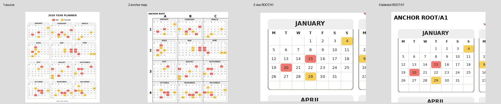

# Foveate Images

Vision agents can notice the correct part of a dense image but still produce unreliable crop coordinates. Foveate Images replaces those coordinates with stable anchors such as `ROOT/B2` and makes lossless crops for each anchor.

The synthetic 2026 calendar shows the problem. It has 12 month panels, small dates, and two highlight colors in one 976 by 1194 image.



A `4 x 3` map assigns one anchor to each month. For example, `ROOT/B2` is May. An agent can inspect all 12 raw crops, record the highlighted dates, and use the printed `RED` and `YELLOW` legend names without estimating pixels.

## Use the skill

Copy `skills/foveate-images` into your agent's skill directory. Then ask the agent to load the skill:

```text
Use $foveate-images to list every highlighted date in eval/examples/classic_warm_2026.png.
Use the color names printed in the legend.
```

The skill includes its own `foveate.py` script. If `uv` is available, PEP 723 metadata installs Pillow in an isolated environment:

```bash
uv run skills/foveate-images/foveate.py map \
  eval/examples/classic_warm_2026.png \
  --output /tmp/foveate-calendar/map \
  --rows 4 \
  --columns 3 \
  --region 32,136,944,1160

uv run skills/foveate-images/foveate.py focus \
  /tmp/foveate-calendar/map/manifest.json \
  --output /tmp/foveate-calendar/focus \
  --all
```

The `map` command writes raw and annotated overviews plus an anchor manifest. The `focus` command writes one lossless raw crop and one labeled navigation copy for each selected anchor. Add `--rows 2 --columns 2` to a focused anchor when its details remain too small.

Use fresh output directories for maps and focus batches. Existing manifests, sources, or planned crop files are never overwritten.

## Discover image structure

The first map defaults to automatic structure discovery. Hough lines, gutters, and repeated panels propose regions. The tool selects a well-supported layout or falls back to a `3 x 3` grid. Headers, legends, and residual areas remain navigable.

```bash
uv sync --extra detection
uv run python skills/foveate-images/foveate.py map IMAGE --output runs/map
```

For a standalone skill copy, enable detection dependencies explicitly:

```bash
uv run --with opencv-python-headless --with numpy \
  skills/foveate-images/foveate.py map IMAGE --output runs/map
```

`structures.json` records probes, candidate geometry, scores, detector skip reasons, selection reasons, and alternative previews. The full image remains available without annotations. Detector scores rank geometry and do not identify semantic objects.

Use `--mode hough`, `--mode gutters`, or `--mode panels` to force a detector. Explicit detectors fail when evidence is insufficient. Use `--mode grid --rows 4 --columns 3` for a uniform grid. Existing commands with grid dimensions keep their grid behavior.

Select a reported alternative with `--discovery runs/map/structures.json --candidate ID`. Refine an anchor with `focus --mode auto` or explicit detector modes. Each refinement writes an immutable successor manifest. `focus --all` always means immediate children of `ROOT`, including when the map contains descendants.

Detection needs the optional OpenCV and NumPy dependencies. Without them, automatic mode reports the missing capability and selects the grid. Explicit grid and legacy focus operations require only Pillow. Camera perspective correction remains future work.

Transparent images are analyzed and annotated against white. Raw images retain their original alpha and pixels.

Legacy palette-image manifests retain their original identity checks, which did not authenticate palette colors. New maps include rendered palette colors in source identity.

## Benchmark structure discovery

```bash
uv sync --extra detection
uv run python scripts/benchmark_autostructure.py --output reports
uv run python -m unittest test_autostructure -v
```

The benchmark creates synthetic workloads, JSON measurements, and a standalone HTML report under the ignored `reports/` directory. It compares automatic selection, an ungated detector ablation, each explicit detector, and a uniform grid. The report separates detection quality, crop invariants, latency, and peak memory. Negative cases include known false positives on line art and single frames.

An optional local-model extraction trial runs with `uv run python scripts/evaluate_calendar_vision.py --output reports`. Afterward, `uv run python scripts/benchmark_autostructure.py --output reports --render-only` adds its results to the report. This five-calendar trial reports differing request and token budgets and supports only an exploratory comparison.

The example truth file at `eval/examples/classic_warm_2026.truth.json` contains the exact highlighted date and color pairs. It is useful for evaluation, but do not give it to the agent during a blind test.

The `eval/examples/` directory includes all five generated calendars, their truth sidecars, and a contact sheet for evaluation.

## Generate more calendars

The fixture generator creates five deterministic calendars with different years, layouts, week starts, palettes, and aspect ratios:

```bash
uv sync
uv run generate-calendars
```

Generated files go under the ignored `runs/` directory.

## Check the project

```bash
uvx ruff@0.16.3 check .
uvx ruff@0.16.3 format .
uvx pyright@1.1.411
uv run python3 test_foveate_tools.py
uvx pre-commit@4.6.2 run --all-files
```

## License

MIT
