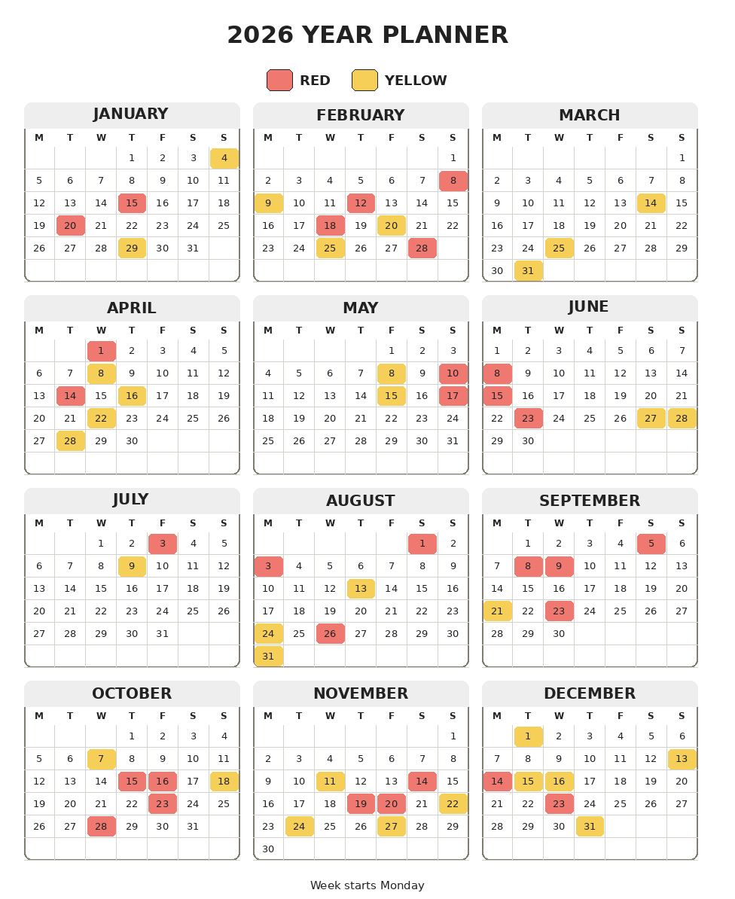

# Foveate Images

Vision agents can notice the correct part of a dense image but still produce unreliable crop coordinates. Foveate Images replaces those coordinates with stable anchors such as `ROOT/B2` and makes lossless crops for each anchor.

The synthetic 2026 calendar shows the problem. It has 12 month panels, small dates, and two highlight colors in one 976 by 1194 image.



A `4 x 3` map assigns one anchor to each month. For example, `ROOT/B2` is May. An agent can inspect all 12 raw crops, record the highlighted dates, and use the printed `RED` and `YELLOW` legend names without estimating pixels.

## Use the skill

Copy `skills/foveate-images` into your agent's skill directory. Then ask the agent to load the skill:

```text
Use $foveate-images to list every highlighted date in examples/classic_warm_2026.png.
Use the color names printed in the legend.
```

The skill includes its own `foveate.py` script. If `uv` is available, PEP 723 metadata installs Pillow in an isolated environment:

```bash
uv run skills/foveate-images/foveate.py map \
  examples/classic_warm_2026.png \
  --output /tmp/foveate-calendar/map \
  --rows 4 \
  --columns 3 \
  --region 32,136,944,1160

uv run skills/foveate-images/foveate.py focus \
  /tmp/foveate-calendar/map/manifest.json \
  --output /tmp/foveate-calendar/focus \
  --all
```

The `map` command writes raw and annotated overviews plus an anchor manifest. The `focus` command writes one lossless raw crop and one labeled navigation copy for each selected anchor. Add `--rows 2 --columns 2` to a focused anchor when its details remain too small.

The example truth file at `examples/classic_warm_2026.truth.json` contains the exact highlighted date and color pairs. It is useful for evaluation, but do not give it to the agent during a blind test.

## Generate more calendars

The fixture generator creates five deterministic calendars with different years, layouts, week starts, palettes, and aspect ratios:

```bash
uv sync
uv run generate-calendars
```

Generated files go under the ignored `runs/` directory.

## Check the project

```bash
uvx ruff@0.16.3 check .
uvx ruff@0.16.3 format .
uvx pyright@1.1.411
uv run python3 test_foveate_tools.py
uvx pre-commit@4.6.2 run --all-files
```

## License

MIT
